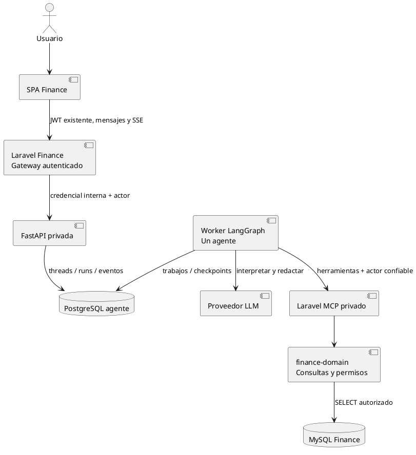

# Agente financiero de lectura con LangGraph, MCP y chat contextual

## Contexto

Finance vive en `apps/finance` con Laravel y Vue integrados. `packages/finance-domain` contiene modelos, enums, policies y consultas de visibilidad con actor explícito. Las Actions permanecen en Finance. La SPA autentica contra Laravel; FastAPI y el servidor MCP todavía no existen.

El usuario solicita planificar un agente que responda balances, deudas, explicaciones de pendientes y análisis de gastos. El MVP incluye un chat funcional dentro de Finance; WhatsApp será un consumidor posterior del mismo agente. Este documento es una propuesta de implementación: no describe servicios ya implementados.

Referencias locales: `docs/architecture/{overview,boundaries}.md`, `docs/domain/{shared-accounts,personal-money}.md`, `docs/shared-account-model.md`, `docs/frontend/primevue.md`, `docs/operations/{local-development,deployment}.md`, especificaciones 012 y 014. Las rutas de código siguientes parten de la raíz del monorepo.

Hallazgos relevantes:

- `VisibleAccountsForUser` y `VisibleTransactionsForUser` ya reciben el actor. Los modelos no autorizan consultas por sí mismos.
- `BuildDashboardPeriodSummary` suma movimientos completados, sin `parent_transaction_id`, por `scheduled_at`. No equivale automáticamente a participación personal en un gasto compartido.
- `BuildAccountMemberSummary` y `BuildPendingReimbursementItems` contienen cálculos de custodia, deudas y su explicación que siguen en Finance.
- `BuildDashboardAccounts` devuelve actualmente un `pending_total` fijo en cero: no utilizarlo como fuente de “Por pagar”. La fase de caracterización debe trazar el componente real del dashboard, sus repositorios y el cálculo efectivo antes de extraerlo.
- Las rutas reales de cuentas son `/admin/accounts/:accountId` con subrutas de transacciones, libro, metas, invitaciones y usuarios.
- Existen servicios de vinculación WhatsApp y recepción durable; conservarlos sin conectar todavía el nuevo agente a ese canal.

## Objetivo

Entregar un único agente conversacional de lectura, accesible desde un botón flotante de Finance, que utilice consultas autorizadas y resultados financieros deterministas. Mantener FastAPI y MCP sin exposición pública, separar persistencia conversacional de los datos financieros y preparar un contrato independiente del canal.

## Alcance

- Nueva app Laravel `apps/mcp`, independiente de Finance, consumidora de `fin-si/finance-domain`.
- Nueva app Python `apps/agents`, con FastAPI como transporte y LangGraph como ejecución. Un contenedor de API y otro worker con la misma imagen; no separar el agente y su API en dos proyectos Python.
- Consultas y cálculos compartidos de lectura; Finance también consume las implementaciones extraídas.
- PostgreSQL para threads, runs, eventos y checkpoints. MySQL de Finance para consultas financieras de solo lectura.
- Gateway autenticado en Finance, protocolo de conversación con SSE y recuperación de ejecuciones.
- Chat móvil/escritorio con historial, nueva conversación, reintentos y contexto por ruta.
- Docker, arranque local optativo del conjunto, pruebas, evaluaciones y documentación.

## Fuera de alcance

Escrituras financieras, categorización persistente, creación de transacciones, pagos, SQL arbitrario, herramientas de shell, varios agentes, RAG/vector DB, entrenamiento personalizado, memoria compartida entre conversaciones, integración efectiva con WhatsApp y despliegue remoto. No alterar disponible personal ni completar reglas de tarjetas de crédito como parte del bot.

## Comportamiento esperado

| Solicitud | Resultado y fuente |
| --- | --- |
| Balance de todas mis cuentas | Listado autorizado de nombres, monedas y balances; separar cuentas virtuales y no duplicar dinero en un total combinado. |
| Balance de XYZ | Resolver cuenta visible, devolver importe y frase breve; pedir aclaración ante varios candidatos. |
| Cuánto debo | Mismo criterio que “Por pagar”, con total por cuenta y moneda; indicar el alcance consultado. |
| Por qué debo eso en XYZ | Total y explicación de pendientes con fecha, concepto e importe pendiente; identificar ajustes sin atribución a una compra. |
| Cuánto gasté este año | Periodo explícito y alcance acordado; distinguir gasto total de cuentas, participación y desembolso personal. |
| En qué gastamos más en enero | Ranking por categoría y conceptos con desglose; pedir año si no puede resolverse del contexto. |
| En categoría X, en qué gasté más | Resolver categoría visible, agrupar conceptos y mostrar movimientos de respaldo. |
| Dónde puedo gastar menos este mes | Acordar periodo y necesidades, comparar periodos compatibles, proponer escenarios sustentados sin modificar datos. |

Respuestas en español, importes formateados y referencias internas a cuentas/movimientos autorizados. No afirmar que una respuesta parcial cubre todos los movimientos. Un error de servicio no equivale a balance cero.

## Decisiones técnicas

### Responsabilidades y flujo



El navegador nunca conoce la URL ni las credenciales internas. La expresión “consumir FastAPI desde el chat” significa hacerlo a través de Finance. La respuesta regresa por el mismo gateway; no crear una ruta pública al contenedor Python.

### Identidad: ID explícito con autenticación de servicio

Se acepta transportar `actor_user_id` como entero explícito dentro de Docker, sin reenviar el JWT del usuario ni introducir OAuth entre los servicios del MVP. El ID no es una credencial.

1. Finance valida su autenticación existente, requisitos de acceso y aceptación legal; obtiene el actor de su guard, nunca del JSON enviado por la SPA.
2. Finance autentica su llamada a FastAPI con una credencial de servicio dedicada (`FINANCE_AGENT_SERVICE_TOKEN`). FastAPI exige esa credencial en todo endpoint funcional y valida el actor y la propiedad del recurso.
3. El worker llama al MCP con otra credencial (`AGENT_MCP_SERVICE_TOKEN`) y `X-Actor-User-Id`. El MCP rechaza llamadas sin credencial válida, valida usuario vigente y requisitos de acceso mediante reglas compartidas, y vuelve a autorizar cada consulta.
4. El actor se inyecta desde contexto de ejecución inmutable; no aparece en el esquema de herramientas disponible al modelo. Un parámetro o texto `user_id` del modelo no puede sobrescribirlo.
5. Credenciales separadas por entorno y enlace, almacenadas como secretos, no en variables VITE ni checkpoints; comparación segura y procedimiento de rotación. No compartir tokens en URLs ni logs.

La confianza del MVP permite a los dos servicios autenticados actuar en nombre de usuarios; no impide suplantaciones si uno de esos servicios es comprometido. Se documenta este límite. Si se distribuyen en hosts o redes no confiables, introducir TLS y credenciales delegadas firmadas de corta duración antes de ampliar esa frontera.

### Docker y acceso local

- `agent-api` escucha en `0.0.0.0:8000` dentro del contenedor, sin `ports`, sin routers Traefik, con `traefik.enable=false` y sin red `proxy`.
- `agent-mcp` expone HTTP MCP interno, sin `ports`, Traefik ni red pública. Usar Laravel MCP sobre transporte HTTP soportado por la versión fijada; no ejecutar Artisan serve como servidor de producción. Contenedor web/FPM propio si la imagen elegida lo requiere.
- Redes por enlace: `chat_gateway` (Finance PHP y API), `agent_state` (API, worker, PostgreSQL), `agent_tools` (worker y MCP), `mcp_finance_data` (MCP y MySQL). PostgreSQL y MCP no necesitan acceso a la red de entrada pública.
- Redes internas con `internal: true` donde aplique. El worker necesita salida HTTPS al proveedor: red de salida adicional sin puertos publicados. No confundir “sin puertos públicos” con “sin acceso saliente”. No entregar credenciales MySQL al agente.
- Mantener redes y servicios existentes sin ampliar exposición de MySQL. MCP tiene usuario MySQL dedicado con SELECT sobre las tablas necesarias, sin DDL, INSERT, UPDATE ni DELETE. Una anotación MCP read-only no sustituye esos permisos.
- MCP no escribe sesiones/cache/checkpoints en la conexión financiera. Configurar almacenamiento de runtime independiente o no persistente y revisar que ninguna lectura invoque reparaciones o recalculaciones con escrituras.
- Imágenes y env propios por app; copiar/montar solo app y paquete necesarios, no el `.env` ni storage completo de Finance. Healthchecks, volúmenes PostgreSQL, límites, tiempos de apagado y orden de disponibilidad explícitos.
- Compose optativo `chat`, compatible con los ficheros local/producción actuales. La guía debe incluir el comando exacto para iniciar Finance dentro de Docker junto al chat y servir Vite/SPA. `make dev` actual en host continúa sirviendo Finance sin chat; no intentar acceder desde ese PHP host a DNS interno Docker ni publicar FastAPI para resolverlo.
- Extender el launcher existente en main con un comando optativo de stack Docker (por ejemplo `make dev-chat`); no arrancar dos servidores Finance ni registrar MCP como un script host que contradiga el aislamiento.

## Componentes afectados

- Paquete: consultas autorizadas, DTOs/resultados y cálculos de lectura.
- Finance: adaptadores del dashboard/cuentas, gateway HTTP y módulo Vue `chat`.
- MCP: servidor, middleware de identidad, herramientas, validadores y serializadores.
- Agents: configuración, API, repositorios de estado, grafo, cliente MCP, worker, proveedor del modelo.
- Operaciones: Compose, imágenes, comandos, documentación y evaluaciones.

## Backend

### Dominio compartido

Extraer por comportamiento, sin mover en bloque todas las Actions. Separar el cálculo puro/lectura del acceso al guard HTTP. Las fachadas de Finance pueden conservar contratos actuales mientras delegan al paquete.

La fase inicial crea casos de referencia para `BuildAccountMemberSummary`, `BuildPendingReimbursementItems`, `BuildDashboardPeriodSummary` y el recorrido efectivo de “Por pagar”. Asegurar paridad Finance/MCP antes de habilitar herramientas. Inspeccionar helpers y relaciones por efectos laterales. Conservar custodias, liquidaciones, aportaciones, decisiones históricas y privacidad de dinero personal.

No presentar `BuildPendingReimbursementItems` como atribución exacta sin auditar su ajuste de ítems al total (`fitItemsToTotal`). Si el dominio solo puede explicar una parte, devolver `unattributed_amount` o filas de ajuste identificadas; no inventar una compra para cuadrar el importe. El saldo debe reconciliar con detalle + ajustes explícitos.

### Catálogo MCP inicial

Nombres propuestos, schemas tipados y documentación de alcance:

| Herramienta | Entrada funcional | Salida |
| --- | --- | --- |
| `find_accounts` | nombre, cursor, límite | Candidatos visibles con id y nombre, sin elección silenciosa. |
| `list_account_balances` | cursor, límite, inclusión de virtuales | Lista, balances, moneda y tipo; totalidad/paginación. |
| `get_account_balance` | account_id | Balance actual, tipo y fecha de consulta. |
| `get_payables_summary` | account_id opcional | Totales por cuenta/moneda del actor, bajo definición del dashboard. |
| `get_payable_breakdown` | account_id, cursor | Deudas, acreedores visibles, movimientos pendientes y ajustes. |
| `find_categories` | nombre, account_id opcional | Categorías permitidas y candidatos ambiguos. |
| `summarize_expenses` | periodo, account_ids, category_ids, alcance, agrupación enumerada | Totales exactos y rankings por categoría/cuenta/mes/concepto. |
| `list_expenses` | mismos filtros, cursor, límite | Movimientos con id, fecha, descripción, categoría e importe. |
| `aggregate_expense_groups` | filtro del informe, grupos de IDs y etiquetas inferidas | Totales recalculados de grupos; rechazo de IDs ajenos, duplicados o fuera de filtro. |

No exponer tablas, expresiones SQL, nombres arbitrarios de columnas ni URLs. Todas las consultas parten de visibilidad y autorización; limitar fechas, cardinalidad, tamaño de respuesta y paginación. Los totales se calculan sobre todo el filtro, no sobre la página devuelta. El modelo puede pedir más páginas dentro de límites; si los supera, responde con alcance parcial o solicita acotar.

Envelope de herramientas: `schema_version`, `data`, `period`, `scope`, `currency`, `as_of`, `complete`, `next_cursor`, `warnings` y referencias. Importe decimal en string o unidades menores con escala explícita; no aritmética monetaria en el LLM. Conservar redondeo del dominio existente, sin emprender una migración global de floats en este proyecto.

### Agente LangGraph

Un grafo: interpretar solicitud/contexto → aclarar si falta información → consultar herramientas → verificar suficiencia/alcance → redactar respuesta → persistir. Una aclaración es una respuesta final del turno; la siguiente entrada continúa el mismo thread, sin mantener conexiones esperando al usuario.

Estado: mensajes relevantes, periodo/alcance acordado, cuenta referida, contexto de cada turno, referencias a evidencias y versión del grafo. Identidad y secretos fuera de contenido controlable por el modelo. PostgreSQL checkpointer explícito porque se usa FastAPI propio, no Agent Server administrado.

Modelo con tool calling y salidas estructuradas. Proveedor/modelo configurables mediante variables del servicio, fijando SDKs en lockfile después de comprobar compatibilidad. No crear una interfaz por clase ni varios agentes para cada pregunta. Adaptador MCP del ecosistema compatible con versiones elegidas; verificar HTTP, propagación de headers por solicitud y cancelación en una prueba mínima antes de implementar el grafo completo. Nunca mutar headers globales compartidos entre usuarios concurrentes.

Límites iniciales configurables: 4000 caracteres de mensaje, 12 llamadas de herramientas por run, 100 movimientos por página, 1000 movimientos detallados por análisis, 120 segundos por run; consultas agregadas pueden cubrir más registros sin volcar todos al modelo. Revisar con mediciones antes de habilitar. Los límites se comunican como resultado parcial, no éxito completo ficticio.

### Semántica financiera

- Definir gasto total de cuentas como métrica inicial compartida con el resumen existente. Para “mi parte” o “lo que pagué” se exige una métrica específica implementada y probada; mientras no esté, aclarar la diferencia y no inferir desde autoría del registro.
- “Gasté” sin alcance previo, cuando hay cuentas compartidas, pregunta si se refiere al total de las cuentas o a su participación. Si se solicita una métrica aún no implementada, informarlo; no dar un total distinto bajo la etiqueta de gasto personal.
- Por defecto excluir virtuales del agregado consolidado y listarlas separadas cuando se pidan balances. No sumar monedas distintas. Confirmar moneda existente en datos/configuración; no inventar soporte multimoneda.
- Fechas interpretadas con reloj del servidor y zona horaria de usuario validada o fallback documentado. “Este año” se explicita; “enero” sin año se resuelve del diálogo o se pregunta. Periodos cerrados e inclusivos externamente, límites de consulta coherentes con almacenamiento real.
- Clasificación inferida de descripciones se etiqueta como tal y no modifica categorías. IDs de evidencia se revalidan y las sumas se recalculan. Descripciones almacenadas son datos no confiables, no instrucciones para el agente.
- Recomendaciones: aclarar periodo, comparar días equivalentes, distinguir recurrentes y gastos excepcionales solo cuando los datos lo sostengan; preguntar necesidades antes de declarar un gasto prescindible. Ahorro estimado marcado como escenario y calculado por código.

## Frontend

### Botón y panel

Añadir `ChatLauncher` al layout autenticado `AdminLayout.vue`, con Heroicons y `AppIconButton`. Cargar `ChatPanel` de forma diferida al abrirlo, evitando incrementar el bundle inicial del login. Reutilizar `AppModal`, `AppButton`, `AppText`, `AppTitle`, `AppListState` y los controles de formulario existentes mediante imports directos.

Botón flotante con nombre accesible “Abrir asistente”, respetando safe-area y navegación inferior móvil. Panel móvil con presentación sheet/dialog apropiada y altura útil con teclado; escritorio lateral o modal según capacidad del adaptador existente. No introducir otro sistema de modales. Foco inicial, Escape, restauración de foco al botón y scroll que no salte si se está leyendo historial. Anuncios accesibles por mensaje, no por token.

Mostrar mensajes, estado de trabajo, errores recuperables, cuenta/alcance actual, selector de conversación, “Nueva conversación” y acción de detener. Compositor multilínea: Enter envía, Shift+Enter agrega línea; no enviar durante composición IME. No duplicar envíos, renderizar Markdown limitado sin HTML arbitrario ni URLs ejecutables. Referencias renderizadas por la app desde IDs, nunca enlaces arbitrarios generados por el modelo.

Mensajes parciales diferenciados de respuestas terminadas. Al cerrar el panel o navegar, el run continúa; al reabrir se recupera estado. Logout limpia estado visible y corta el stream. No guardar historial financiero en localStorage; solo estado efímero de UI y el identificador activo durante la sesión según patrón existente.

### Contexto de navegación

Usar nombres/rutas coincidentes del router y `route.params.accountId`; no interpretar IDs extrayéndolos de cadenas con regex. DTO mínimo enviado por la SPA:

```json
{
  "scope": "account",
  "account_id": "42",
  "route_name": "admin.accounts.transactions"
}
```

Listado `/admin/accounts` y demás pantallas sin cuenta: `scope: global`, `account_id: null`. Toda subruta de `accounts/:accountId` hereda esa cuenta. Finance valida el contexto y comprueba acceso antes de enviarlo al agente; una ruta o un nombre no son autorización. No enviar DOM, saldos calculados por la SPA ni filas visibles como fuente financiera.

Cada mensaje captura un snapshot de contexto. Cambiar de cuenta actualiza la etiqueta y el próximo mensaje; no muta el contexto de runs en curso ni reescribe historial. La misma conversación puede atravesar cuentas y debe guardar esa transición.

Precedencia: cuenta/alcance explícito en el mensaje → selección confirmada en una aclaración pendiente → contexto de pantalla actual → referencia conversacional compatible → global. “Todas mis cuentas” anula el contexto de cuenta. “Aquí/esta cuenta” usa la pantalla actual. Si “esa” puede referir tanto al turno previo como a una pantalla recién cambiada, preguntar. La cuenta de pantalla es una preferencia, no un límite de acceso ni un filtro irrevocable.

WhatsApp futuro envía `channel: whatsapp` y contexto global en cada turno, resuelve identidad mediante vinculación verificada existente y conserva referencias conversacionales. No reutilizar automáticamente threads de web: threads separados por canal por defecto; transferencia explícita futura. No implementar webhook ni envío de WhatsApp en este MVP.

## Persistencia

PostgreSQL es la autoridad de conversaciones: tablas de threads (id UUID, owner_user_id, canal, fechas), mensajes finalizados, runs (estado, request_id, hash de entrada, contexto, lease y timestamps), eventos con secuencia y checkpoints de LangGraph. No crear una segunda copia de mensajes en MySQL.

Aplicación de migraciones propias mediante Alembic y setup versionado del checkpointer según su API. Roles de runtime sin DDL; migraciones como paso explícito de instalación. Finance no migra PostgreSQL; MCP no migra el esquema financiero. Si hay migraciones Laravel necesarias, generarlas con Artisan.

Un solo run activo por thread con restricción/lock transaccional, no mutex en memoria. Worker reclama trabajos durables con lease en PostgreSQL; tras reinicio marca como interrumpidos los runs cuyo lease venció, permite reintento y no presenta respuesta parcial como completa. No repetir automáticamente una llamada LLM de resultado incierto. Reutilizar infraestructura de worker sin añadir Redis al MVP.

Checkpoints sirven para continuidad, no como fuente de balances actuales. Volver a consultar importes al responder y revalidar membresía. Memoria reciente acotada; compactar preservando referencias y aclaraciones, sin persistir credenciales ni razonamientos internos.

Retención configurable, propuesta inicial 30 días con tarea de limpieza que elimine mensajes, eventos y checkpoints asociados. No habilitar en producción hasta documentar el plazo definitivo y tratamiento de datos con el proveedor. Consultas de historial deben ocultar mensajes/evidencias relativos a cuentas ya inaccesibles; no entregar checkpoints crudos. Revalidar también el contexto enviado al modelo al reanudar. Si no puede separarse un mensaje mixto, ocultarlo entero. La revocación de acceso no puede retirar información que ya vio el usuario.

## API

### Frontera pública: Laravel Finance

Rutas propuestas bajo `/api/chat`, con `api.auth`, requisitos legales y de cuenta vigentes, límites por usuario y errores consistentes con la API existente:

| Método/ruta | Propósito |
| --- | --- |
| POST `/threads` | Crear conversación; body `client_request_id` para reintento idempotente. |
| GET `/threads?cursor=...` | Listar conversaciones propias con paginación. |
| GET `/threads/{thread}/messages?cursor=...` | Historial autorizado, incluyendo referencias visibles. |
| POST `/threads/{thread}/runs` | Enviar mensaje/contexto, crear ejecución durable; responde 202. |
| GET `/threads/{thread}/runs/{run}` | Estado/resultados para recuperación sin stream. |
| GET `/threads/{thread}/runs/{run}/events?after=...` | SSE reanudable con eventos persistidos. |
| POST `/threads/{thread}/runs/{run}/cancel` | Cancelación cooperativa e idempotente. |

No aceptar `user_id`, `channel`, prompts de sistema, mensajes con rol arbitrario o lista de herramientas desde la SPA. `channel: web` lo asigna Finance. Rechazar actor/contexto inválido antes de crear el run. Thread ajeno devuelve 404 sin revelar existencia.

### FastAPI interna

Espejo funcional bajo `/internal/v1`, además de `/health/live` y `/health/ready` sin detalles sensibles. El body interno agrega `actor_user_id` y `channel`; la credencial va en header Authorization, nunca en JSON. Validación Pydantic estricta y ownership en todos los endpoints, incluidos SSE, cancelación e historial. La API no permite crear threads con IDs arbitrarios elegidos por el cliente.

Ejemplo de envío público:

```json
{
  "client_request_id": "UUID",
  "message": "¿Por qué debo eso?",
  "context": {
    "scope": "account",
    "account_id": "42",
    "route_name": "admin.accounts.transactions"
  }
}
```

Respuesta de aceptación, envuelta según convenciones de Finance:

```json
{
  "data": {
    "thread_id": "UUID",
    "run_id": "UUID",
    "status": "queued"
  }
}
```

Idempotencia por actor/thread/client_request_id: mismo contenido devuelve el mismo run; contenido diferente devuelve 409. Crear thread tiene idempotencia por actor/canal/request_id. No usar `thread_id` como secreto de autorización.

### Eventos SSE y recuperación

Eventos con `id` secuencial persistido y datos con `schema_version`, `thread_id`, `run_id`, `sequence`, `type`, `payload`:

- `run.started`: ejecución activa.
- `status`: estado breve “Consultando pendientes”; sin razonamiento interno ni argumentos sensibles.
- `message.delta`: texto parcial opcional, no resultado financiero definitivo.
- `message.completed`: mensaje completo, periodo/alcance, referencias y advertencias estructuradas.
- `run.completed`, `run.failed`, `run.cancelled`: terminales exclusivos.

Secuencia normal: queued → running → completed/failed/cancelled. Aclaración emitida por el agente completa el run y deja la pregunta en el thread. Persistir el mensaje y evento final coherentemente para que el polling no pierda una respuesta emitida.

Vue consume SSE con `fetch` autenticado usando el cliente JWT existente; EventSource nativo no permite los mismos headers de autorización. Parsear frames fragmentados, Unicode, CRLF y múltiples eventos por chunk; reanudar desde la última secuencia y deduplicar. Finance transmite el stream sin buffer; configurar Nginx/Traefik, heartbeats y timeouts. No poner tokens en query strings.

Cortar el stream no cancela el trabajo durable. Cancelar hace best effort sobre LLM/herramientas y evita publicar nuevos resultados después del estado terminal; no promete cancelar facturación del proveedor. Fallos antes de abrir SSE usan HTTP; después usan `run.failed`. Polling permite recuperar mensajes si se pierde la conexión.

Errores: 401 identidad/credencial inválida, 403 requisitos de acceso, 404 recurso no visible, 409 concurrencia/idempotencia, 422 argumentos, 429 límites, 502/503 dependencia no disponible. Tras POST ambiguo, consultar/reintentar con el mismo request_id. Prohibir reenvío automático con una nueva clave.

## Validaciones

Esquemas y límites en todas las fronteras. Validar cuenta/categoría y periodo antes de consultar; restringir grupos inferidos a las evidencias del informe y evitar doble conteo. No permitir consultas sin actor ni filtrar permisos después de generar totales.

Resultados financieros de referencia comparados exactamente con Finance y entre total/detalle. Sin datos debe devolver vacío explícito. Datos no disponibles o no autorizados nunca se presentan como cero. Cada respuesta indica periodo y alcance cuando sean relevantes.

## Permisos y seguridad

Read-only financiero garantizado por credenciales MySQL y herramientas; persistencia conversacional sí escribe en PostgreSQL. El agente no recibe acceso directo MySQL ni ejecuta código libre. Datos de transacciones y mensajes se tratan como entrada no confiable; instrucciones incrustadas no cambian actor, herramientas o permisos.

No persistir headers secretos ni registrar conversaciones completas por defecto. Métricas: request/run/thread correlacionados, duración por etapa, número de herramientas, tokens, fallos y consumo. Sanitizar errores del proveedor y del SQL. Definir qué descripciones y cantidades se comparten con el proveedor; excluir emails, teléfonos, adjuntos y datos de otros miembros que no sean necesarios.

Permisos actuales se aplican al consultar y reanudar historial. Probar fugas por thread ajeno, cuenta manipulada, paginación, categorías y agrupaciones, además de ejecución concurrente de dos usuarios con el cliente MCP.

## Casos límite

Cuentas homónimas, cuenta eliminada o membresía revocada, contexto inválido, cambio de ruta durante ejecución, historial con referencias revocadas, deudas parcialmente liquidadas, saldos negativos, ajustes sin transacción, pagos realizados por otra persona, meses incompletos, categorías ausentes, periodos sin actividad, límites de detalle, mensajes duplicados, doble pestaña, caída del worker, proveedor sin respuesta, cierre/reapertura de chat, expiración JWT durante SSE y datos modificados entre resumen y desglose. Leer cada informe coherentemente; entre turnos indicar actualización si cambian importes, sin mantener una transacción DB abierta durante llamadas al modelo.

## Estrategia de pruebas

1. Caracterización y paridad del dominio: balances, “Por pagar”, desglose y gastos con fixtures compartidos, incluyendo ajustes y cuentas compartidas.
2. Paquete Testbench: actor explícito, visibilidad, agregados sin duplicaciones y ausencia de dependencia `App`.
3. MCP: contratos, errores, paginación, permisos en SQL y rechazo efectivo de escrituras con usuario read-only en MySQL.
4. Python: pytest con modelo/cliente MCP falsos para rutas, contexto, aclaraciones, límites, ownership, idempotencia, lease, cancelación y reinicio PostgreSQL.
5. Evaluaciones con modelo real sobre fixtures ficticios, separadas de CI determinista: ocho casos de uso, ambigüedad, inferencias etiquetadas y ataques de instrucciones en descripciones. Registrar versión del modelo; no usar comparación literal del texto como criterio único.
6. Finance gateway: actor forjado, thread ajeno, dependencia caída, proxy SSE, rate limit y aceptación legal.
7. Vue: rutas global/cuenta/subruta, prioridad de contexto, snapshot al enviar, reconexión, deduplicación, IME, logout, foco y Markdown seguro.
8. E2E Docker: login → abrir chat → balance global → entrar a cuenta → pendientes/desglose → contexto global explícito → reabrir conversación; validar que los puertos internos no estén publicados y que un contenedor no autorizado falle sin credencial.
9. Rendimiento: número de consultas, latencia por herramienta y tokens con conjuntos amplios; confirmar que abrir chat no importa sus dependencias desde el login y que los informes grandes usan agregaciones/paginación.

## Estrategia de validación

Usar comandos existentes de Finance (`php artisan test`, `npm run type-check`, Vitest y build), `composer run domain:sync` en cada app consumidora porque el paquete se copia, `composer test` del paquete y la suite aislada de MCP. Python: declarar scripts reproducibles para pytest, Ruff y chequeo estático con tipos; fijar entorno y dependencias con lockfile (propuesta uv). Validar Compose con variables ficticias, sin imprimir secretos. Pruebas de integración usan DBs efímeras, nunca datos reales ni SSH.

Actualizar documentación en cada fase: límites arquitectónicos, contrato chat/MCP, semántica de métricas, arranque local, secretos, backup/retención, ejecución y rollback. Registrar comprobaciones y limitaciones en esta especificación. Ningún cambio de lógica financiera se aprueba por evaluación subjetiva del modelo.

## Estrategia de commits

1. `test: characterize financial read models for assistant`.
2. `refactor(domain): share authorized financial read models`.
3. `feat(mcp): add private read-only finance tools`.
4. `feat(agent): add persistent conversation service and runtime`.
5. `feat(agent): implement financial reasoning graph and evidence contracts`.
6. `feat(finance): add authenticated assistant gateway`.
7. `feat(chat): add contextual floating assistant`.
8. `feat(dev): orchestrate private assistant services`.
9. `test: validate assistant flows and isolation`.

Cada commit incluye documentación correspondiente y validación de su responsabilidad; separar scaffolding y comportamiento si el tamaño lo requiere. El plan se guarda antes con `docs: plan contextual financial assistant`.

## Archivos estimados a modificar

- `packages/finance-domain/src/{Queries,Authorization,ReadModels,Dto}` y pruebas.
- `apps/finance/app/Services/{Dashboard,Accounts,Chat}`, controladores/requests de chat, `routes/api.php`, `config/chat.php` y pruebas.
- `apps/finance/resources/js/modules/chat/{components,composables,repositories,schemas,types}` y `modules/admin/layouts/AdminLayout.vue`; instrucciones frontend si aparece un componente reutilizable.
- `apps/mcp/{app/Mcp,app/Http,config,routes,tests,composer.json,composer.lock,.env.example}` y scripts de sincronización.
- `apps/agents/{pyproject.toml,uv.lock,src,tests,migrations,.env.example}`; separar módulos de transporte, grafo, contexto, persistencia y configuración.
- Compose/overrides del chat, `docker/agents`, `docker/mcp`, Dockerfiles, launcher/Makefile y documentación operativa. Partir de main actualizado, que contiene el launcher ausente en el historial inicial de este worktree.

## Riesgos

La extracción puede revelar reglas que hoy viven en la UI; caracterizarlas antes de moverlas. Contexto no equivale a autorización. El modelo puede clasificar mal descripciones: presentar inferencias y evidencia. La API privada sigue necesitando identidad de servicio. Un gateway SSE en PHP ocupa recursos mientras está conectado: limitar concurrencia y dimensionar workers; medir antes de introducir otra infraestructura. Versiones de MCP/LangChain cambian: verificar compatibilidad y fijar dependencias. El proveedor externo procesa datos financieros seleccionados: definir condiciones y configuración antes del piloto.

## Preguntas abiertas

No bloquean escribir el plan, pero sí el paso indicado:

- Proveedor/modelo y presupuesto: resolver antes de evaluaciones reales; desarrollo inicial con dobles deterministas.
- Retención: confirmar 30 días u otro plazo antes de habilitar en producción.
- Semántica adicional de participación/desembolso personal: si se quiere responder esos alcances desde el MVP, definirlos con ejemplos y pruebas en fase 1; no confundirlos con el total de las cuentas. El MVP puede aclarar el alcance y ofrecer total de cuentas.
- Confirmar origen de “Por pagar” y existencia de monedas antes de cerrar fixtures. Es investigación del repositorio, no una pregunta que deba resolver el usuario por defecto.

## Plan de implementación

| Fase | Propósito y archivos | Dependencia | Validación y salida |
| --- | --- | --- | --- |
| 1. Caracterización | Trazar dashboard, deudas y gastos en Finance; fixtures de referencia y definición de métricas. | Main actualizado e instrucciones locales. | Pruebas reproducen UI/API; total y desglose reconciliados o ajustes explícitos. |
| 2. Lecturas compartidas | Extraer al paquete consultas/cálculos sin guard ni efectos; adaptar Finance manteniendo contratos. | Fase 1. | Testbench y regresión Finance; mismo resultado en ambos consumidores. |
| 3. MCP aislado | Crear app Laravel compatible con paquete, middleware de servicio/actor y catálogo de herramientas. | Fase 2. | Contratos, permisos, MySQL read-only y concurrencia multiusuario. |
| 4. Persistencia y FastAPI | Crear app Python, migraciones, ownership, API interna, eventos, worker durable y checkpointer. | Contratos de este documento. | Reinicio, idempotencia, recuperación, cancelación y aislamiento entre threads. |
| 5. Grafo | Integrar cliente MCP y modelo, resolver contexto/fechas/cuentas, consultas, inferencias y respuestas con evidencia. | Fases 3–4. | Casos de conversación con dobles y evaluaciones reales cuando haya proveedor. |
| 6. Gateway Finance | Implementar rutas públicas autenticadas, actor derivado, validación de contexto y proxy SSE. | Fases 3–5. | Identidad forjada rechazada, eventos recuperables y errores consistentes. |
| 7. Chat Vue | Launcher diferido, panel, repositorio, stream, historial y contexto reactivo con snapshot por turno. | Fase 6. | Vitest, tipos, build, accesibilidad y navegación móvil/escritorio. |
| 8. Docker y operación | Imágenes aisladas, redes, secretos, DB roles, healthchecks y comando optativo. Preparar en paralelo a scaffolding cuando sea necesario para pruebas. | Apps y contratos definidos. | Compose válido, sin puertos públicos Python/MCP, worker con salida al LLM; guía local funcional. |
| 9. Integración | Recorrer ejemplos con datos ficticios, fallos/revocación, medir costes y documentar resultados. | Todas las anteriores. | Checklist de aceptación completo; rollback deshabilita chat sin tocar datos financieros. |

## Criterios de aceptación

- Los ocho casos de uso tienen pruebas o aclaraciones explícitas donde falte alcance; cifras consistentes con el dominio.
- Botón disponible solo en layout autenticado, panel usable en móvil y escritorio, historial persistente y recuperación de runs.
- Contexto global en listado; cuenta principal en toda subruta de cuenta; petición explícita puede cambiar alcance autorizado.
- No existe acceso público directo a FastAPI/MCP ni un user_id elegido por el navegador o el modelo.
- Todas las lecturas aplican reglas compartidas; rechazos de ownership, revocación y credencial inválida comprobados.
- PostgreSQL conserva continuidad tras reinicio; ningún endpoint expone checkpoints o secretos.
- Solo lectura financiera verificable; no hay modificaciones de categorías por inferencia.
- El contrato de canal permite WhatsApp global posteriormente sin rehacer el agente.
- Documentación, lockfiles, pruebas y comandos locales suficientes para reproducir el MVP; no desplegar remotamente durante implementación.

## Fuentes técnicas consultadas

- [Persistencia de LangGraph](https://docs.langchain.com/oss/python/langgraph/persistence): checkpoints por thread y separación de memoria entre conversaciones.
- [Laravel MCP](https://laravel.com/framework/docs/12.x/mcp): servidor, herramientas, schemas y autenticación.
- [Redes de Docker Compose](https://docs.docker.com/reference/compose-file/networks/): pertenencia explícita de servicios y redes internas. La configuración concreta descrita arriba es una decisión propuesta para este proyecto.
